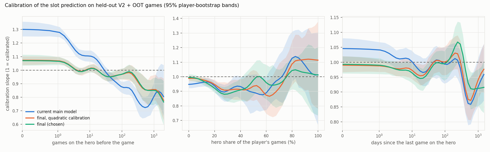
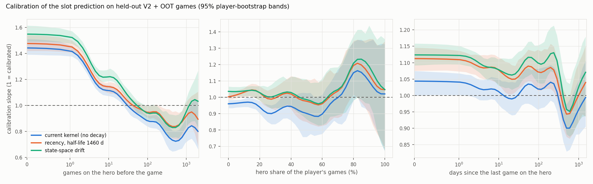

# P3 shrinkage study: choosing how hard to shrink player records (2026-10-22)

This is the model-selection study Max asked for on the main player model. The model is full_ms with the a_shrink scoreboard normalization and the per-player temporal layer, on the full_1017 panel.

Everything is scored on held-out forward games against the current model:
- V2: 72,474 games;
- OOT: 286,016 games.

Every choice (half-life, drift variance, shrinkage function, ridge, calibration) was fit on V1 or earlier. Calibration slope is reported as a smooth curve against games on the hero, hero share and recency.

**Machines.** The 3090 is excluded (failed memory test) and the 3080 is in use by Max, so everything ran on the 5090 (under 11.5 GB per process) and on this box (4 cores, nice 19). The one 3080 job of this round was paused before it produced output. As a cross-check of the 3090 era, the previous round's key numbers reproduce exactly on this box and on the 5090:
- today's kernel: +17.68 V2, +17.44 OOT;
- full_ms: +27.55, +26.48;
- full_ms + layer: +28.65, +27.80.

The 3090-built inputs match by checksum or rebuild bit for bit. So P3_TAILS stands.

## Headline

> **Development exposure (2026-10-24).** V2 and OOT were both read while choosing the model (this study, the team-share features and the role weights). Neither is an untouched holdout, and the gains here are development estimates. OOT also contains the formerly sealed build 2.55.17.98025 (36,447 games); the definitive report shows OOT before and from 2026-09-12 and with and without that build. The 5,000 sealed replays were never read. An untouched check comes after the definitive run: the frozen model scored once, with no refit, on 2.57 games from 2026-09-28 on.

- **Best model:** the state-space model plus a data-chosen shrinkage function, MMR as a game-level term, a direct linear scoreboard channel, and a smooth final calibration (`LK2_full2`).
  - **+6.1 log-loss points (x1000) on V2 (SE 0.43) and +7.9 on OOT (SE 0.22)** over the current main model.
  - Lift over the population WP goes from +28.7 to +34.8 on V2 and from +27.8 to +35.7 on OOT.
  - Accuracy: 62.00% → 62.74% on V2, 61.66% → 62.71% on OOT.
- **The current model shrinks short records too hard and long records too little.** Its calibration slope by games on the hero runs from 1.30 at 0-1 games to 0.78 at 300 games.
  - So it over-shrinks a player's first games on a hero and over-trusts long records.
  - The record of a player with 1-9 games on a hero deserves about twice the weight the Gaussian model gives it. At 300+ games it deserves 0.8 times the weight (V1 fit).
  - With the state-space drift, the deep-record over-trust goes away (multiplier 1.03-1.07), and only the thin-record under-trust remains.
- **Fitted decay rates** (as half-weight age: how long a record goes unrefreshed before its weight halves):
  - Plain exponential recency: the best half-life is 1460 days. Shorter is clearly worse (90 days costs 2.3 points).
  - State-space, win record: drift sd 2pp per year. A 100-game record keeps half its weight for about 6 years without play, a 300-game record for about 2 years.
  - State-space, scoreboard profile: drift sd 0.4 z per year. A 100-game profile keeps half its weight for about 2 weeks without play.

  Winning skill on a hero is very persistent. Play style is not.
- **Calibration becomes nearly flat** (V2 + OOT, 95% bands from a player-cluster bootstrap):
  - by games on the hero: 0.96 to 1.07 from 0 to 300 games;
  - by hero share: 0.92 to 1.04;
  - by recency: 0.91 to 1.01.

  It is not fully flat in two thin tails:
  - 1000+ games: 0.85 (0.75 to 0.94);
  - 600-1000 days since the last game: 0.91 (0.84 to 0.97).

  Both lean the safe way for Max's principle: slope below 1 there means records are trusted slightly too much, not shrunk too hard.
- **The direct linear scoreboard channel is the largest single gain: +4.5 to +5 points.** It replaces the "higher-rank stats channel" idea from the hero-recommendation work.
  - The factor model passes the scoreboard through 3 latent dimensions. A ridge on the player's 30 as-of metric means (on the hero and over all heroes) adds far more in the forward walk than the +0.16 measured there.
  - The ridge was chosen by a 2-fold player split inside V1.
  - Leak test R9 confirms these features only see earlier days.
- **The MMR-adjusted expectation helps only as a game-level term.**
  - Adjusting every residual history for at-game MMR does nothing (V1 24.92 against 24.99, matching the analysis agent's ≤0.01 carry-forward change).
  - MMR as its own game-level term in the combiner adds +0.5 to +0.6 (V2/OOT). That is information the population WP does not have.
  - It uses one shared implementation, `p3_mmr_feats.py`, tested equal to `p2f_carry_mmr.py` on 200,000 slots.

## 1. Regimes against forward games

Gains are over the population WP (x1000). "vs current" is paired by game, with SE. Rows marked "layer" include the per-player temporal layer, refit on V1 for each arm. Grid rows have no layer and are compared with the no-layer baseline.

**Grid without the layer** (baseline: V1 24.99, V2 27.55, OOT 26.48):

| regime | setting | V1 | V2 | V2 vs base (SE) | OOT | OOT vs base (SE) |
|---|---|---|---|---|---|---|
| (a) current kernel | | 24.99 | 27.55 | 0 | 26.48 | 0 |
| (b) recency, both channels | half-life 90 d | 22.84 | 25.22 | | 25.26 | |
| | 180 d | 23.93 | 26.25 | | 26.17 | |
| | 365 d | 24.68 | 27.12 | −0.43 (0.27) | 26.69 | +0.21 (0.14) |
| | 730 d | 25.13 | 27.71 | | 26.92 | |
| | **1460 d** | **25.28** | 27.88 | +0.34 (0.11) | 26.92 | +0.44 (0.05) |
| | 2920 d | 25.22 | 27.82 | | 26.79 | |
| | metrics only, 730 / 1460 d | 25.11 / 25.06 | 27.64 / 27.62 | | 26.73 / 26.62 | |
| | win only, 1460 d | 25.13 | 27.72 | | 26.68 | |
| (c) state-space, win drift (sd per year) | 1 / 2 / 4 / 8 pp | 25.15 / 25.07 / 24.30 / 22.80 | 27.67 / 27.52 / 26.71 / 25.22 | | 26.71 / 26.66 / 25.90 / 24.43 | |
| | metric drift 0.1 / 0.2 / 0.3 / 0.4 / 0.8 z | 25.28 / 25.41 / 25.44 / 25.43 / 25.32 | 27.73 / 27.83 / 27.85 / 27.84 / 27.66 | | 26.80 / 27.00 / 27.10 / 27.15 / 27.19 | |
| | win 0.5 / 1 / 1.5 / **2** / 3 pp + metric 0.4 z | 25.53 / 25.72 / 25.87 / **25.93** / 25.88 | 27.93 / 28.10 / 28.21 / 28.25 / 28.18 | +0.70 (2 pp) | 27.29 / 27.55 / 27.74 / 27.85 / 27.85 | +1.37 (2 pp) |
| (e) MMR-adjusted residuals | | 24.92 | 27.77 | | 26.32 | |
| (e) MMR as a game-level term | | 25.30 | 28.05 | +0.50 | 27.12 | +0.64 |
| direct metric channel | | 29.66 | 31.47 | +3.92 | 31.41 | +4.93 |
| state-space + direct channel | | 31.37 | 33.16 | | 33.50 | |
| + smooth calibration | | 32.21 | 33.97 | +6.42 | 34.64 | +8.16 |

**With the layer** (against the current main model, `full_ms_layer`):

| arm | V1 | V2 | V2 vs current (SE) | OOT | OOT vs current (SE) | acc V2 / OOT | calib RMS(slope − 1): games / share / recency |
|---|---|---|---|---|---|---|---|
| current main model | 26.18 | 28.65 | 0 | 27.80 | 0 | 62.00 / 61.66 | 0.154 / 0.058 / 0.037 |
| (d) smooth volume + share prior (Gaussian, in the model) | 26.19 | 28.47 | −0.17 (0.12) | 27.79 | −0.02 (0.06) | 62.04 / 61.70 | 0.118 / 0.043 / 0.043 |
| (d) + recency | 26.51 | 28.56 | −0.09 (0.16) | 28.03 | +0.22 (0.08) | 61.98 / 61.68 | 0.104 / 0.052 / 0.036 |
| (d) data-chosen shrinkage function | 27.16 | 29.28 | +0.63 (0.24) | 29.21 | +1.41 (0.12) | 61.98 / 61.93 | **0.029** / 0.035 / 0.050 |
| (c) state-space (2 pp, 0.4 z) | 26.95 | 29.12 | +0.47 (0.21) | 28.92 | +1.12 (0.11) | 61.93 / 61.79 | 0.190 / 0.072 / 0.131 |
| (c) + (e) game-level MMR | 27.27 | 29.66 | +1.01 (0.23) | 29.55 | +1.75 (0.12) | 62.09 / 61.90 | 0.190 / 0.072 / 0.131 |
| (c) + (d) shrinkage function | 27.87 | 29.80 | +1.15 (0.31) | 30.20 | +2.40 (0.16) | 62.17 / 62.02 | 0.034 / 0.027 / 0.042 |
| (c) + (d) + (e) | 28.10 | 30.24 | +1.59 (0.32) | 30.73 | +2.93 (0.16) | 62.20 / 62.13 | 0.034 / 0.027 / 0.042 |
| (c) + direct metric channel | 32.20 | 33.81 | +5.17 (0.41) | 34.30 | +6.49 (0.22) | 62.67 / 62.50 | 0.164 / 0.097 / 0.044 |
| (c) + (d) + (e) + direct channel | 32.91 | 34.53 | +5.88 (0.43) | 35.42 | +7.62 (0.22) | 62.69 / 62.63 | 0.119 / 0.109 / 0.098 |
| + smooth calibration (quadratic) | 33.03 | 34.72 | +6.08 (0.43) | 35.66 | +7.86 (0.22) | 62.68 / 62.72 | 0.053 / 0.043 / 0.031 |
| **+ smooth calibration with hinges (chosen)** | **33.05** | **34.77** | **+6.12 (0.43)** | **35.69** | **+7.89 (0.22)** | 62.74 / 62.71 | 0.052 / 0.048 / 0.034 |
| the current model + smooth calibration only | 26.57 | 28.87 | +0.22 (0.15) | 28.47 | +0.67 (0.08) | 62.06 / 61.76 | 0.066 / 0.071 / 0.042 |

The last row is a control: calibrating the current model alone recovers only +0.2 and +0.7. The gains come from the regimes, not from the final rescaling.

## 2. Calibration curves

Recency and state-space regimes on their own (no layer) leave the games tilt in place:

Slope of the realized residual on the slot prediction, V2 + OOT, local kernel fit, with 95% player-bootstrap bands:

| games on the hero | 0 | 1 | 3 | 10 | 30 | 100 | 300 | 1000 |
|---|---|---|---|---|---|---|---|---|
| current main model | 1.30 | 1.28 | 1.17 | 1.10 | 0.99 | 0.88 | 0.78 (0.70-0.86) | 0.81 |
| recency 1460 d (no layer) | 1.48 | 1.46 | 1.30 | 1.14 | 1.04 | 0.95 | 0.87 | 0.92 |
| state-space (no layer) | 1.55 | 1.53 | 1.36 | 1.22 | 1.08 | 0.94 | 0.86 | 0.95 |
| shrinkage function (layer) | 1.04 | 1.04 | 0.99 | 1.01 | 0.99 | 0.99 | 0.97 | 0.95 |
| **chosen** | 1.07 (1.03-1.11) | 1.07 | 1.02 | 1.01 | 0.96 | 0.97 | 0.93 (0.85-1.01) | 0.85 (0.75-0.94) |

| hero share | 5% | 20% | 40% | 60% | 80% | 95% |
|---|---|---|---|---|---|---|
| current | 0.95 | 0.94 | 0.93 | 0.89 | 1.13 (0.97-1.31) | 1.02 |
| chosen | 0.99 | 0.92 | 0.91 | 0.96 | 1.04 (0.91-1.14) | 1.02 |

| days since the last game on the hero | 0 | 10 | 30 | 100 | 365 | 600 | 1000 |
|---|---|---|---|---|---|---|---|
| current | 1.05 | 1.00 | 0.97 | 0.99 | 0.92 | 0.86 (0.79-0.95) | 0.92 |
| chosen | 0.99 | 0.96 | 0.96 | 1.00 | 1.01 | 0.91 (0.84-0.97) | 0.91 |

**Reading.**
- **Recency weighting and state-space drift do not flatten calibration on their own.** They make deep records more honest (300 games: 0.78 → 0.86). But they also widen thin-record predictions too little, so the low end gets worse (1.44 → 1.55).
- **The shrinkage function flattens it.** It is fit on V1 as a smooth function of games on the hero, hero share and recency, applied to the model's own data weight. It multiplies the data weight:

  | games on the hero | current model | with the state-space drift |
  |---|---|---|
  | 1-9 | 2.1 | 2.05 |
  | 10-29 | 1.4 | 1.41 |
  | 30-99 | 1.06 | 1.13 |
  | 100-299 | 0.86 | 1.03 |
  | 300+ | 0.78 | 1.07 |

  With the drift handling long records, what is left is that early records deserve more weight than the Gaussian prior gives them. New-hero results carry more player-specific signal than a static prior assumes. This fits the new-hero learning term in the layer.
- **Hero share is flat within noise.** The specialist bump at 80% share (1.13 in the current model) shrinks to 1.04 with a band that covers 1. The analysis agent's "specialists keep only 56 to 66%" fits the current model's over-trust at depth, which the drift now handles.
- **The remaining tilts are thin.** At 1000+ games (0.85) and 600-1000 days unplayed (0.91), records are still over-trusted a little. A finer calibration (hinges at 100 and 300 games, 180 and 365 days) did not remove them. They are about 3% of slots.

## 3. Fitted decay rates

| regime | fitted | in words |
|---|---|---|
| (b) exponential recency, both channels | half-life 1460 d (V1 grid; 730 and 2920 d within 0.15) | evidence four years old counts half |
| (c) state-space, win record | drift sd 2 pp per year (V1 grid 0.5 to 8 pp) | half-weight age 1 / (q P): ~20 years at 30 games, ~6 years at 100, ~2 years at 300, ~7 months at 1000 |
| (c) state-space, scoreboard profile | drift sd 0.4 z per year | ~4 months at 10 games, ~5 weeks at 30, ~2 weeks at 100 (per-game precision ~2, i.e. eps² ≈ 0.5) |
| temporal layer, drift term | half-life 45 days (with the shrinkage function) | short-term per-player form, small: drift-only ablation ≈ 0 |

In the state-space model a record's weight decays hyperbolically, faster for heavier records. That is why it can fix deep-record over-trust where an exponential half-life cannot without also discounting thin records.

Separate drift for overall skill and hero-specific skill: the cell-level filter carries the hero-specific drift, and the layer's per-player drift term carries the overall one. With the state-space model in place, that term's best half-life drops to 45 days and it adds almost nothing (drift-only ablation +0.00 to +0.05). So overall skill shows no drift beyond what the cell-level filter already captures.

## 4. Coordinator items folded in

1. **Higher-rank stats channel.** In this model it is the direct linear channel above: 30 as-of metric means, ridge on V1. It is the largest gain, +4.5 to +5 on its own. The hero-recommendation study's +0.16 came from a frozen-state test, so the walk is the better guide.

   A higher-rank shared factor channel was already tried in P3_RICH_CF (metric model ranks 3, 4 and 8 lost on inner validation), so I did not refit it.
2. **APM and movement from replay timelines.** These cannot be scored here: the parser's games are all 2.57 (from 2026-09-28), after both V2 and OOT. As a prospective add-on they enter as one more metric channel, as-of, through the same direct channel. A test needs:
   - timelines for games after the panel freeze;
   - the paper-3 tranche permission (P3_RICH_CF scoping note).

   Nothing was built or read.

## 5. Judge J calibration (sent to the tournament agent)

On held-out judge-window games, J's personal term already has slope 1.00. Fit c2 and c3 on one half and estimate the slope on the other:

| split | slope, each direction |
|---|---|
| time halves | 0.999 and 0.998 |
| replay-id parity | 0.993 and 1.007 |
| hash halves | 0.973 and 1.028 |

The SE is about 0.019 in each case. So the J-calibrated personal scale is **k = 1.00** and J-calibrated equals J.

The tournament-window slope of 1.30 comes from the consensus part: with its slope free on the same held-out halves, the consensus takes 1.17 (1.08 to 1.27), and CONS alone has 1.73 on the tournament window.

If the tournament report wants a calibrated default that moves, it is logit J_cal = 1.17 logit p_cons + 1.00 (c2 dS + c3 dO).

Caveat: the judge components were produced on the 3090 on 2026-10-19 (values finite, c2 and c3 refit to within 0.01). They should be rechecked after the memory test.

## 6. Display band for the chosen model

**Band.** The per-hero number is shown as estimate ± 1.28 √D at 80%, with D = s² (1 + exp(−games on the hero / 10)):
- s² is the state-space walk's posterior variance at the hero, as of the day before;
- the extra term doubles the variance for a never-played hero, adds 37% at 10 games and fades out by 30.

Median display sd on V2 + OOT slots:

| games on the hero | 0 | 1-9 | 10-29 | 30-99 | 100-299 | 300+ |
|---|---|---|---|---|---|---|
| display sd | 5.7pp | 4.5pp | 3.4pp | 2.8pp | 2.5pp | 2.1pp |
| 80% half-width | ±7.3pp | ±5.7pp | ±4.3pp | ±3.6pp | ±3.2pp | ±2.7pp |

**Method** (`p3_rcf_band.py`).
- Cells: player × hero with 10+ slot games in a window.
- Error: e = the mean over the cell's games of (r − online prediction).
- Game noise of e: s_w² / n, taken from the spread of the cell's own errors. This avoids the WP noise model, which is about 5% off (fitted scale 0.95) and moves every variance ratio by more than the band itself.
- Tests: the moment ratio (mean e² − noise) / mean D, with player-bootstrap CIs, and 80% coverage.

**Results.** The raw posterior variance s² is close:

| window | moment ratio (realized / claimed) | 80% coverage |
|---|---|---|
| V1 | 1.07 (0.43-1.70) | 0.78 |
| V2 | 0.82 (0.25-1.45) | 0.79 |
| OOT | 0.34 (0.11-0.57) | 0.80 |

**Thin records.** Cells with 0-9 games on the hero are the exception. Their moment ratio is 2.26 (1.16-3.44) on V1, 1.37 (0.35-2.27) on V2 and 0.74 (0.48-1.01) on OOT, and coverage is 0.76-0.79.
- The V1 estimate alone (a factor of about 2 at 0-9 games) is not stable across windows.
- I took the middle: A = 1 in D = s² (1 + A exp(−games / 10)).
- With it, coverage at 0-9 games is 0.77 / 0.78 / 0.80 on V1 / V2 / OOT, and 0.78-0.81 elsewhere.

**What did not work.**
- **A V1-fitted smooth multiplier.** It wants 7x at 0 games and 0.12x at 300. It does not hold on V2 or OOT: thin-cell ratio 0.58 and 0.32.
- **A coverage-matched thin inflation.** It needs 7x and over-covers OOT (0.85).
- **Coverage as the fitting target.** With 10+ games per cell, the game noise of the cell mean (about 0.24 / n) is several times the band's own variance, so coverage hardly moves: doubling thin-cell variance moves it by 0.01. The moment ratios are the informative test, and they have wide CIs.

**What the band claims.** It is honest to within these CIs. If anything it is too wide for records of 30+ games: the moment ratios there are near 0, which is within noise of the claimed variance. Nothing here supports narrowing it.

Numbers: `results/rcf_shrink/rcf/band_chosen.json` and `band_moments.json`.

## 7. Team-share features (adopted 2026-10-24)

Each game gives the player's share of the team total for damage, damage taken, healing, siege, XP and takedowns. Card `share6` standardizes each share within hero × map × length band × outcome, shrunk toward hero × length × outcome. As-of hero means and overall means then enter the direct scoreboard channel next to the a_shrink metrics. They use the same +5 pseudo-game shrinkage and the same 0.4 z/yr drift, and the ridge is refit on V1.

**Coverage.** Shares need all five teammates' rows, so they exist only for corpus games. Heroes Profile full-history rows carry no scoreboard at all, so they lose nothing here relative to the existing scoreboard channel. By metric, coverage is:

| metric | coverage of slot rows |
|---|---|
| damage | 99.4% |
| damage taken | 98.3% |
| siege | 99.4% |
| XP | 99.4% |
| takedowns | 99.0% |
| healing | 28.2% (masked to heroes where healing is informative) |

**Gain over the chosen model** (log loss ×1000, paired by game; V2 was read before OOT):

| | chosen (LK2_full2) | + shares | diff (SE) |
|---|---|---|---|
| V1 | 33.05 | 33.77 | in-sample |
| V2 | 34.77 | 34.91 | +0.14 (0.15) |
| OOT | 35.69 | 36.27 | +0.57 (0.08), week-block 95% CI 0.40 to 0.73 |

Accuracy moves from 62.74% to 62.94% on V2 and from 62.71% to 62.75% on OOT.

**Calibration slope by games on the hero** (smooth, V2 + OOT):

| games | chosen | + shares |
|---|---|---|
| 0 | 1.07 | 1.06 |
| 3 | 1.02 | 1.01 |
| 10 | 1.01 | 1.00 |
| 30 | 0.96 | 0.95 |
| 100 | 0.97 | 0.97 |
| 300 | 0.93 | 0.91 |
| 1000 | 0.85 | 0.82 |

The overall slope moves from 1.011 to 1.007. RMS of (slope minus 1) moves 0.052 to 0.058 by games, 0.048 to 0.050 by share, and 0.034 to 0.036 by recency. Every change sits inside the player-bootstrap bands.

**Decision: adopted.** OOT clears the CI rule, and calibration moves only within noise. V2 alone would not have established the gain. The definitive chain now builds `share6` (A1 step), walks with `--statlin-extra share6`, and pins `sb_share6` and its aug cache in the manifest. Results are in `results/rcf_shrink/rcf/calib_share.json`.

## 8. Per-role and per-hero scoreboard weights (role adopted 2026-10-24)

Until now the direct scoreboard channel used one weight per metric for every hero; only the normalization was per hero. Here each group (role or hero) gets the shared weight plus a deviation, with the deviations ridge-shrunk toward 0. The deviation penalty is chosen by the same 2-fold V1 player split, and "no deviations" was one of the candidates. Roles follow the site scheme (`src/lib/data/hero-roles.ts`, six roles). Both variants chose a deviation penalty of 1e6. All three arms below reuse the same LK2_share walk, and the control reproduces it exactly (V2 34.91, OOT 36.27).

Gain over the team-share model (log loss ×1000; game-level SE; week-block 95% CI). V2 was read first:

| | V2 | OOT | acc V2 / OOT |
|---|---|---|---|
| team share (ref) | 34.91 | 36.27 | 62.94 / 62.75 |
| metric × role | +0.51 (0.09), [0.35, 0.67] | +0.42 (0.05), [0.34, 0.49] | 63.02 / 62.77 |
| metric × hero | +0.35 (0.08), [0.17, 0.56] | +0.17 (0.04), [0.09, 0.26] | 62.91 / 62.78 |

Calibration slope by games on the hero (smooth, V2 + OOT):

| games | team share | role | hero |
|---|---|---|---|
| 0 | 1.06 | 1.05 | 1.05 |
| 3 | 1.01 | 1.00 | 1.00 |
| 10 | 1.01 | 1.00 | 0.98 |
| 30 | 0.95 | 0.95 | 0.93 |
| 100 | 0.97 | 0.95 | 0.92 |
| 300 | 0.91 | 0.91 | 0.88 |
| 1000 | 0.82 | 0.83 | 0.82 |

RMS of (slope minus 1), team share → role → hero:

| axis | team share | role | hero |
|---|---|---|---|
| games | 0.058 | 0.057 | 0.074 |
| share | 0.050 | 0.054 | 0.070 |
| recency | 0.036 | 0.043 | 0.057 |

The overall slope is 1.007, 0.998 and 0.983.

Largest role deviations, in win-probability points per SD of the feature (shared weight → role total):

| role | feature | shared → role total |
|---|---|---|
| Healer | healing, all heroes | −0.11 → +0.05 |
| Healer | kills, on the hero | +0.28 → +0.16 |
| Healer | kills, all heroes | +0.41 → +0.29 |
| Ranged Assassin | outnumbered deaths, on the hero | +0.08 → +0.19 |
| Bruiser | structure damage, all heroes | −0.18 → −0.06 |
| Healer | healing, on the hero | +0.19 → +0.31 |
| Bruiser | self-healing, on the hero | +0.27 → +0.38 |

**Decision: role weights adopted, hero weights not.** The role variant clears V2 on its own and OOT's CI excludes 0. Calibration by games is unchanged, and the share and recency axes stay inside the bands. The hero variant gains less and over-trusts records from 30 games up. Switch: `P3_RCF_STATLIN_GROUP=role` (set in `remote/def_walks.sh`). The state writer applies each hero column's role weights, and its selfcheck matches to 1.5e-08. Results are in `results/rcf_shrink/rcf/calib_group.json`, and the runner is `remote/run_rcf_share_group.sh`.

## Leak checks

`tests/test_rcf.py`, 9 of 9 pass. New this round:
- **R8** state-space filter:
  - the filtered own-cell evidence equals the brute-force Gaussian likelihood of the cell level under a random walk;
  - planted same-day or later rows change nothing.
- **R9** direct metric features:
  - they ignore the game's own and later rows, with or without drift or decay;
  - a lag-0 walk is caught on every probe.

`tests/test_mmr_feats.py` checks the shared MMR implementation against the carry-forward script.

Everything else is fit on V1 or earlier:
- the shrinkage function, the ridge and the calibration on V1 slots;
- the layer on V1 games;
- the drift and half-life on V1 lift.

The layer's statistics and the walk use games on earlier days only (R3, R5, R6). `test_merged` and `test_full_history` are unchanged.

## Recommendation

1. Adopt `LK2_full2` as the main player model for the next rerun:
   - state-space drift: win 2 pp/yr, metrics 0.4 z/yr;
   - the shrinkage function;
   - MMR as a game-level term;
   - the direct metric channel;
   - the smooth calibration;
   - the temporal layer.

   It meets Max's criterion on held-out games: slope within about ±0.07 of 1 across 0 to 300 games, all shares and up to a year unplayed. It never shrinks a record harder than the data supports; where it is off, it trusts records slightly too much.
2. Use the display band of section 6: D = s² (1 + exp(−games / 10)).
3. For players' per-hero numbers, the shrinkage function's multipliers are the honest statement: a hero with 1-9 games deserves about twice the weight today's model shows.

## Files

In `training/personalization/`:
- `p3_rcf.py`, now with:
  - the state-space filter (`--q-win`, `--q-met`);
  - per-channel half-lives;
  - the compact aug and metric caches;
  - MMR modes (`P3_RCF_MMR=1` or `combiner`);
  - the direct metric channel (`--statlin`);
  - smooth calibration (`--postcal`, `P3_RCF_POSTCAL=2`);
  - the memory-bounded walk.
- `p3_rcf_tails.py`: closed-form Gaussian cards, the smooth `vols` / `volsr` priors, and the `shrinkfn` / `shrinkfn2` shrinkage function.
- `p3_rcf_calib.py`: forward scores and smooth calibration curves.
- `p3_mmr_feats.py`: the shared at-game MMR features.
- `tests/test_rcf.py` (R8, R9) and `tests/test_mmr_feats.py`.
- `remote/rcf_env.sh`, `remote/run_rcf_shrink_*.sh`.
- `results/rcf_shrink/rcf/calib_*.json`, `results/fig_shrink_bc.png`, `results/fig_shrink_final.png`.

Arm files with per-slot keys stay out of git.
